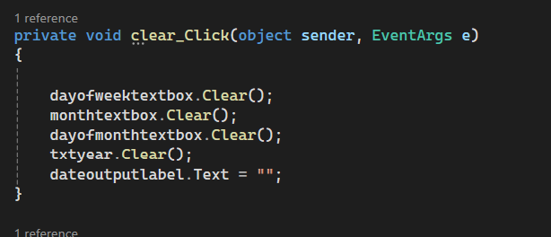

# C# Date Formatter & Clear Application

A simple C# Windows Forms application designed to capture date components from user input fields (⁠ TextBox ⁠), concatenate them into a full formatted date string, display the result in a ⁠ Label ⁠, and clear the form fields when needed.

---

## 🚀 Features

•⁠  ⁠*Show Date (⁠ showdate_Click ⁠):*
•⁠  ⁠Captures input values from textboxes representing the day of the week, month, day of the month, and year.
•⁠  ⁠Combines these values into a single formatted string (⁠ fulldate ⁠).
•⁠  ⁠Outputs the final date to a designated results label (⁠ dateoutputlabel ⁠).

# 🛠️ Requirements

* **IDE:** Visual Studio (Community, Professional, or Enterprise)
* **Framework:** .NET Framework / .NET Core (Windows Forms App template)

---

## ⚙️ How to Use

1. Clone or download this repository into your local machine.
2. Open the solution file (`.sln`) in **Visual Studio**.
3. Ensure your Windows Form has the following controls mapped properly:
* `dayofweektextbox` (TextBox)
* `monthtextbox` (TextBox)
* `dayofmonthtextbox` (TextBox)
* `txtyear` (TextBox)
* `dateoutputlabel` (Label)
* `showdate` (Button)
* `clear` (Button)

4. Build and run the application (`F5`).
