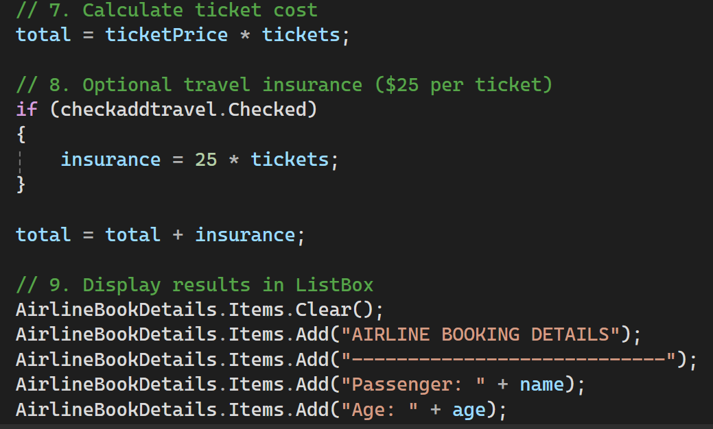
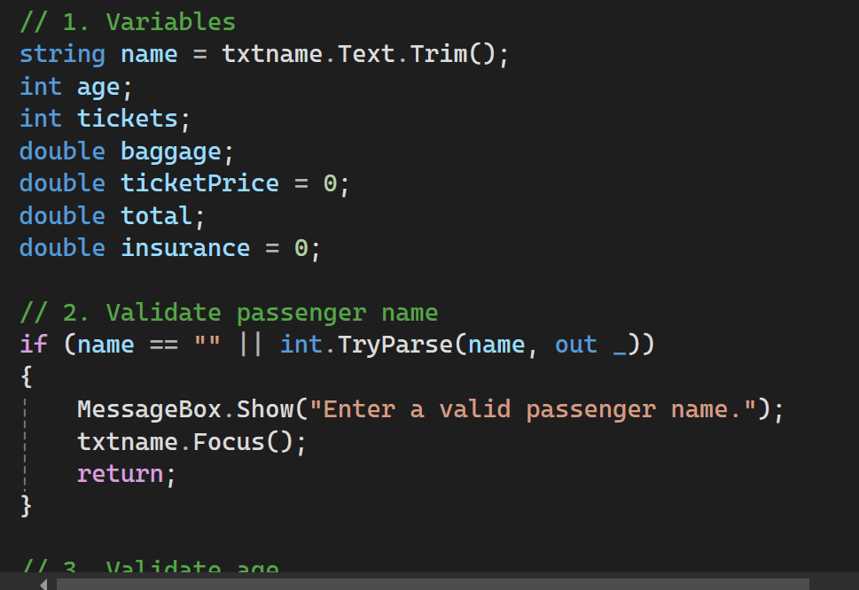

checked lidation
This section documents the first screenshot of the C# Windows Forms Airline Booking System.
Variables
The code declares variables used to store passenger and booking information:
string name = txtname.Text.Trim();
int age;
int tickets;
double baggage;
double ticketPrice = 0;
double total;
double insurance = 0;
- name: stores the passenger's name after removing extra spaces at the beginning and end.
- age: stores the passenger's age.
- tickets: stores the number of tickets.
- baggage: stores the baggage amount or value.
- ticketPrice: stores the price of one ticket; initially set to zero.
- total: stores the final booking cost.
- insurance: stores the travel-insurance cost; initially set to zero.
Passenger Name Validation
if (name == "" || int.TryParse(name, out _))
{
    MessageBox.Show("Enter a valid passenger name.");
    txtname.Focus();
    return;
}
This condition checks whether the passenger name is empty or contains only a valid integer. If either condition is true, the program displays an error message, places the cursor in the name field, and stops the current operation.
Concepts Demonstrated
- Declaring variables and choosing suitable data types.
- Reading text from a Windows Forms TextBox.
- Removing extra spaces with Trim().
- Validating user input with if and int.TryParse().
- Displaying an error using MessageBox.Show().
- Returning focus to a control with Focus().

create variable
This section documents the second screenshot of the C# Windows Forms Airline Booking System.
Decision Structure: Travel Class
The program uses if, else if, and else statements to identify the passenger's selected travel class and assign the ticket price.
if (radiofirst.Checked)
{
    ticketPrice = 500;
}
else if (radionormal.Checked)
{
    ticketPrice = 250;
}
else if (radiobussiness.Checked)
{
    ticketPrice = 400;
}
else
{
    MessageBox.Show("Please select a travel class.");
    return;
}
Ticket Prices
Travel class	Radio button	Price per ticket
First Class	radiofirst	$500
Normal/Economy Class	radionormal	$250
Business Class	radiobussiness	$400

How It Works
1. The program checks whether the First Class radio button is selected. If so, the ticket price becomes $500.
2. Otherwise, it checks whether the Normal/Economy Class button is selected. If so, the price becomes $250.
3. Otherwise, it checks whether the Business Class button is selected. If so, the price becomes $400.
4. If no travel class is selected, an error message appears and the operation stops.
Concepts Demonstrated
- if, else if, and else decision structures.
- Checking radio-button selection using .Checked.
- Assigning values based on user choices.
- Displaying a validation message with MessageBox.Show().
The control name radiobussiness is kept exactly as it appears in the supplied screenshot. Make sure the name matches the control in the Visual Studio Designer.

Display_output  Travel Insurance, and Booking Output
This section documents the third screenshot of the C# Windows Forms Airline Booking System.
Calculate Ticket Cost
total = ticketPrice * tickets;
The program multiplies the selected ticket price by the number of tickets to calculate the ticket cost before insurance.
Optional Travel Insurance
Travel insurance costs $25 per ticket. It is added only when the insurance checkbox is selected.
if (checkaddtravel.Checked)
{
    insurance = 25 * tickets;
}

total = total + insurance;
- If checkaddtravel is selected, insurance is calculated as $25 multiplied by the number of tickets.
- If it is not selected, insurance remains zero.
- The insurance amount is then added to the ticket cost.
Display Booking Details in a ListBox
AirlineBookDetails.Items.Clear();
AirlineBookDetails.Items.Add("AIRLINE BOOKING DETAILS");
AirlineBookDetails.Items.Add("--------------------------------");
AirlineBookDetails.Items.Add("Passenger: " + name);
AirlineBookDetails.Items.Add("Age: " + age);
The code clears the ListBox before adding the booking heading and passenger details. The screenshot shows the beginning of the output section; further booking-detail lines may appear below the visible area.
Total Cost Formula
Total cost = (Ticket price × Number of tickets) + Insurance

If insurance is selected:

Insurance = $25 × Number of tickets
Concepts Demonstrated
- Multiplication and addition in C#.
- Optional services using a CheckBox.
- Checking a CheckBox with .Checked.
- Clearing a ListBox with .Items.Clear().
- Adding output lines with .Items.Add().
- Combining text and variable values using +.
